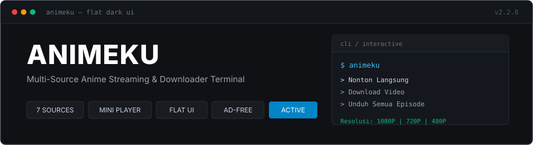

<div align="center">

<a href="https://github.com/rozzak-id/mynimeku-dl">
  
</a>

# Animeku CLI

**Multi-Source Anime Streaming & Downloader Terminal Bebas Iklan**

[](https://nodejs.org/)
[](https://github.com/rozzak-id/mynimeku-dl/releases)
[](./LICENSE)
[](https://nodejs.org/)
[](https://github.com/rozzak-id/mynimeku-dl)

Perkakas terminal open-source untuk mencari, menonton tanpa iklan, dan mengunduh episode anime langsung dari berbagai sumber website dengan resolver otomatis.

</div>

---

## Daftar Website Sumber

Animeku mendukung 7 provider website yang dikelompokkan berdasarkan kategori:

### Kategori Anime Umum
- **MyNimeku** — `https://www.mynimeku.com`
- **Otakudesu** — `https://otakudesu.blog`
- **Samehadaku** — `https://samehadaku.li`
- **Gomunime** — `https://ww2.gomunime.org`
- **LayarAnime** — `https://layaranime.net`

### Kategori Khusus Dewasa 18+
- **NontonHentai** — `https://nontonhentai.net`
- **NekoPoi** — `https://nekopoi.care`

---

## Fitur Utama

- **Pencarian Terpadu**: Cari judul anime di semua provider sekaligus dalam satu pencarian.
- **Beranda Rilis Terbaru**: Langsung lihat anime yang baru diperbarui hari ini layaknya feed beranda.
- **Peralihan Sumber Cepat**: Ketik `:sumber` di terminal untuk berpindah website atau kategori.
- **Nonton Langsung di Mini Player**: Tampilan Flat UI bersih di browser lokal tanpa iklan pop-up.
- **Dukungan HLS Streaming**: Otomatis memutar stream berformat m3u8 dan mp4 secara langsung.
- **Auto Resolver Gateway**: Melewati halaman gateway unduhan seperti MyDriveKu, Hepidrive, Ryuudrive, Pixeldrain, dan Gofile ke tautan file asli.
- **Unduh Tunggal & Batch**: Pilihan unduh satu episode atau seluruh episode serial anime sekaligus.
- **Pilihan Kualitas Video**: Tersedia pilihan resolusi 1080P, 720P, 480P, dan 360P.
- **Penyimpanan Otomatis**: Hasil unduhan langsung tersimpan di folder Downloads laptop, PC, atau memori HP.
- **Resume Download**: Melanjutkan proses download yang terputus tanpa perlu mengulang dari nol.

---

## Panduan Download & Instalasi

### 1. Instalasi di Laptop & PC

Pastikan perangkat kamu sudah terpasang Node.js versi 20 ke atas dan Git.

1. Buka terminal atau Command Prompt atau PowerShell, lalu clone repository:
   ```bash
   git clone https://github.com/rozzak-id/mynimeku-dl.git
   ```

2. Masuk ke direktori proyek:
   ```bash
   cd mynimeku-dl
   ```

3. Pasang seluruh dependensi:
   ```bash
   npm install
   ```

4. Tautkan sebagai perintah terminal global:
   ```bash
   npm link
   ```
   Setelah proses ini selesai, aplikasi dapat langsung dijalankan dari direktori manapun cukup dengan mengetik `animeku`.

---

### 2. Instalasi di Android via Termux

Aplikasi dapat dijalankan penuh di HP Android menggunakan aplikasi Termux.

1. Buka aplikasi Termux, perbarui paket dan pasang Node.js serta Git:
   ```bash
   pkg update && pkg upgrade -y
   pkg install nodejs git -y
   ```

2. Berikan izin akses penyimpanan internal:
   ```bash
   termux-setup-storage
   ```
   Pilih Izinkan pada pop-up di layar HP agar hasil unduhan langsung tersimpan ke folder Download perangkat.

3. Clone repository dan pasang dependensi:
   ```bash
   git clone https://github.com/rozzak-id/mynimeku-dl.git
   cd mynimeku-dl
   npm install
   npm link
   ```

4. Jalankan aplikasi:
   ```bash
   animeku
   ```

---

## Panduan Penggunaan

### 1. Mode Interaktif

Cukup ketik perintah berikut di terminal:
```bash
animeku
```

Menu interaktif akan terbuka dengan bilah pencarian:

- **Melihat Beranda Episode Terbaru**: Tekan tombol Enter pada kolom pencarian tanpa mengetik apa pun. Daftar episode yang baru rilis akan langsung ditampilkan.
- **Mencari Anime**: Ketik nama anime yang diinginkan, misalnya `Solo Leveling` atau `One Piece`.
- **Memilih Website & Kategori 18+**: Ketik `:sumber` pada bilah pencarian, lalu pilih website anime umum atau kategori dewasa 18+.
- **Menempelkan Tautan Langsung**: Tempelkan URL serial atau episode dari website yang didukung untuk langsung diproses.

---

### 2. Memilih Episode, Menonton, atau Download

Setelah serial anime dipilih:
1. Pilih nomor episode yang diinginkan atau pilih opsi **Unduh Semua Episode** untuk batch download.
2. Tentukan kualitas resolusi video: `1080P`, `720P`, `480P`, atau `360P`.
3. Pilih tindakan:
   - **Nonton Langsung**: Membuka pemutar video lokal di browser dengan tampilan Flat UI bebas iklan.
   - **Download Video**: Memulai pengunduhan file video ke folder penyimpanan dengan konfirmasi Y/N.

---

### 3. Mode Perintah Langsung (CLI Command Line)

Kamu juga dapat menjalankan perintah instan tanpa masuk ke menu interaktif:

- **Daftar Provider yang Didukung**:
  ```bash
  animeku providers
  ```

- **Mencari Anime**:
  ```bash
  animeku search "naruto"
  animeku search "one piece" -p samehadaku
  ```

- **Nonton Langsung di Mini Player**:
  ```bash
  animeku play "https://www.mynimeku.com/episode/kusuriya-no-hitorigoto-episode-01-subtitle-indonesia/" -r 720P
  ```

- **Download Satu Episode**:
  ```bash
  animeku download "https://www.mynimeku.com/episode/kusuriya-no-hitorigoto-episode-01-subtitle-indonesia/" -r 720P
  ```

- **Batch Download Seluruh Serial**:
  ```bash
  animeku batch "https://www.mynimeku.com/series/kusuriya-no-hitorigoto/" -r 720P
  ```

---

## Struktur Folder Proyek

```text
mynimeku-dl/
├── assets/
│   └── banner.jpg            # Banner visual repositori
├── bin/
│   └── index.js              # Entry point eksekusi terminal
├── src/
│   ├── config.js             # Konfigurasi default dan deteksi folder Downloads
│   ├── cli/
│   │   ├── commands.js       # Argumen baris perintah Commander
│   │   └── interactive.js    # Tampilan menu terminal interaktif
│   ├── core/
│   │   ├── httpClient.js     # HTTP client dengan penanganan header dan 403 bypass
│   │   └── resolver.js       # Engine pembuka direct link MP4 & HLS dari gateway
│   ├── downloader/
│   │   └── videoDownloader.js# Downloader dengan indikator progress dan resume support
│   ├── player/
│   │   └── miniPlayer.js     # Server mini player lokal bergaya Flat UI
│   └── scrapers/
│       ├── baseScraper.js    # Blueprint abstrak provider
│       ├── gomunime.js       # Provider Gomunime
│       ├── layaranime.js     # Provider LayarAnime
│       ├── mynimeku.js       # Provider MyNimeku
│       ├── nekopoi.js        # Provider NekoPoi 18+
│       ├── nontonhentai.js   # Provider NontonHentai 18+
│       ├── otakudesu.js      # Provider Otakudesu
│       └── samehadaku.js     # Provider Samehadaku
├── LICENSE                   # Lisensi open-source MIT
├── package.json              # Konfigurasi package npm
└── README.md                 # Dokumentasi proyek
```

---

## Disclaimer

Proyek ini dikembangkan untuk tujuan edukasi, riset otomasi, dan arsip pribadi. Seluruh hak cipta konten video dan materi anime sepenuhnya merupakan milik dari pemegang lisensi, studio, dan penyedia konten masing-masing.

---

## Lisensi

Didistribusikan di bawah lisensi terbuka [MIT License](./LICENSE).
